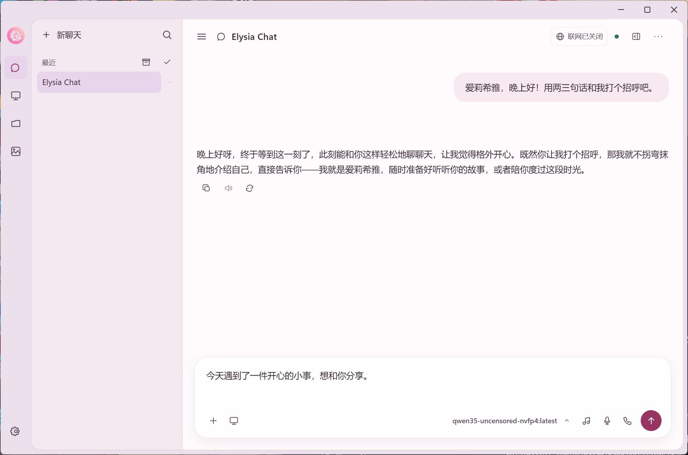

<p align="center">
  
</p>

<h1 align="center">Elysia AI</h1>

<p align="center">在你的电脑上，与你对话。</p>
<p align="center">以爱莉希雅为角色的本地优先 Windows AI 伴侣。</p>

<p align="center">
  <strong>中文</strong> · <a href="./README.en.md">English</a> · <a href="https://github.com/ActorF/Elysia_AI/releases/latest">下载</a> · <a href="#开始使用">开始使用</a> · <a href="./docs/README.md">文档</a>
</p>



[查看深色界面](./docs/assets/desktop-dark.png)

**交付快照：0.1.0 · 2026-10-25。** 当前为预览版本；以下说明对应此版本，模型效果和可选功能取决于本机配置。

## 能做什么

- **本地对话**：流式回复、独立聊天、按范围使用记忆，以及可保存的称呼。
- **项目与资料**：用 Project 组织会话和文件，检索资料并查看回答来源。
- **Work 任务**：按所选权限调用工具和 CMD，查看命令、输出、退出码及文件操作记录。
- **可选扩展**：联网搜索与天气、图片和屏幕理解、语音、本地图片生成、翻唱及外部桌宠。

聊天与数据默认保存在本机。应用内联网默认关闭，截图由用户触发；外部写入另需确认。CMD 使用独立的命令权限，可按当前 Windows 用户权限读写文件、运行程序及访问网络。

## 开始使用

1. 在 Windows 10 / 11 x64 上下载并运行 [Elysia-Setup-0.1.0.exe](https://github.com/ActorF/Elysia_AI/releases/download/v0.1.0/Elysia-Setup-0.1.0.exe)。安装包自带 Python 和基础后端依赖，不需要安装 Node.js、Git 或开发环境。[发布说明与更新](https://github.com/ActorF/Elysia_AI/releases/latest) · [SHA256 校验值](https://github.com/ActorF/Elysia_AI/releases/download/v0.1.0/SHA256SUMS.txt)
2. 单独安装并启动 [Ollama](https://ollama.com/download/windows)，打开 **CMD** 下载默认聊天模型：

   ```bat
   ollama pull qwen3.5:9b
   ollama list
   ```

3. 打开 Elysia，在 **设置 → 通用** 检查模型。默认地址为 `http://localhost:11434`，也可选择另一个已安装的本地模型。若启动提示模型不可用，完成下载或启动 Ollama 后重试。

基础文字聊天不需要云端 API Key 或 `.env`。Ollama 和大模型不包含在 EXE 中；模型下载需要网络与额外磁盘空间，运行速度和内存需求取决于模型与硬件。当前仅支持本机 Ollama，不支持远程或云端模型。

安装包尚未签名，Windows 可能显示未知发布者提示；请核对下载来源与发布的 SHA256。GitHub 的源码 ZIP 不是安装包。

## 日常使用

| 操作 | 入口或行为 |
| --- | --- |
| 聊天与搜索 | 左侧图标切换 Chat / Work，项目下展开会话；`Ctrl+K` 搜索，`Ctrl+B` 展开或收起侧栏。 |
| 输入与停止 | Enter 发送，Shift+Enter 换行；生成时可停止。Work 的重新生成不会重跑命令。 |
| 名字、语言、主题 | `Ctrl+,` 打开设置。通用页保存“你的称呼”，之后的回复使用新称呼；界面支持中文、English 和明暗主题。 |
| 帮助与记录 | 悬停、聚焦或点击信息图标查看说明；Esc 关闭当前浮层。命令、文件变更和来源可展开查看。 |
| 窗口 | 拖动顶部空白处移动，双击最大化或还原；右上角保留 Windows 原生窗口按钮。 |

界面采用珍珠白、玫瑰灰、粉色操作按钮与淡紫选中状态；深色主题使用梅紫底色。两种主题沿用同一布局，外框带极淡香槟色描边，标题栏随主题匹配。

## 按需配置

| 能力 | 准备与限制 |
| --- | --- |
| 时间与联网回答 | 时间读取电脑时钟。在设置中开启 Internet 后，模型可决定搜索或按城市查询天气；明确要求离线时不检索。天气支持当前及今天／明天预报，缺少城市会先询问。[指南](./docs/19-INTERNET-AND-SERVICES.md) |
| CMD | Work 默认“操作前询问”：每条命令在输入区用 Yes / No 确认；“允许 CMD 命令”按当前用户权限直接执行。可检查实际输出，Stop 停止受管理的命令进程；CMD 更改不支持自动撤销。[指南](./docs/17-WORKFLOW-AND-DESKTOP-AGENT.md) |
| 文件问答 | 下载 `qwen3-embedding:0.6b`，向 Project 添加资料，待就绪后启用项目资料。聊天附件不会自动建立项目索引。[指南](./docs/12-KNOWLEDGE-UI-TESTING.md) |
| 图片与屏幕理解 | 添加 PNG/JPEG 后复查，或明确选择单次截图。OCR 需 Tesseract 和语言包；图片问答需已安装的本地视觉模型。[指南](./docs/18-VISION-AND-SCREEN.md) |
| 语音 | 单独准备 Faster-Whisper 模型及 GPT-SoVITS 运行时、模型和授权音频。听写只写入草稿；语音通话发送完整语句。[配置](./desktop/README.md#optional-voice-setup) |
| 图片生成 | 在设置中选择受信 ComfyUI、完整 Python 解释器及兼容 SDXL 模型。[指南](./docs/16-LOCAL-IMAGE-GENERATION.md) |
| 翻唱 | 仅源码环境可用，需要专用 CUDA／WSL 运行时与有权使用的素材；当前安装版不支持。[指南](./docs/15-SONG-COVER.md) |
| 桌宠 | 默认关闭，可选择受支持的外部桌宠程序。[指南](./docs/14-LIVE2D-RUNTIME.md) |

未配置这些扩展不影响基础文字聊天。Work 的“深度思考”需要模型支持；“爱莉希雅的想法”展示处理阶段摘要，不是模型逐字推理。记忆可参与上下文，当前没有独立的记忆浏览或编辑页面。语音效果、GPU 性能和外部运行时兼容性需按实际设备验证。

## 数据与排错

安装版默认数据位于 `%APPDATA%\Elysia\data`，与程序安装目录分开。**设置 → 数据与存储** 可查看实际位置、迁移数据和清理临时文件；迁移后以该页面显示的目录为准。

聊天、资料、设置和图库在数据根目录的 `workspace`，诊断日志在 `logs`；已配置的语音资产在 `models`。Ollama 模型由 Ollama 独立管理。备份前退出应用，并同时保留活动数据目录和 `%APPDATA%\Elysia` 中的配置；移动数据目录不等于备份。不要把聊天、图库或 `models/cache` 当作临时缓存删除。[目录说明](./docs/13-PRODUCTION-DATA-LAYOUT.md)

若无法聊天，先在 CMD 运行 `ollama list`，确认服务和模型，再检查设置中的模型及地址。联网关闭时不会查询实时天气。其他失败请保留界面错误及日志，提交 [Issue](https://github.com/ActorF/Elysia_AI/issues)，并注明版本、Windows 版本和模型名称；分享前移除私人内容。

## 从源码运行

需要 Windows x64、Python 3.14、Node.js 24、Git 和 Ollama。在 **CMD** 中执行：

```bat
git clone https://github.com/ActorF/Elysia_AI.git
cd /d Elysia_AI
py -3.14 -m venv .venv
.venv\Scripts\python.exe -m pip install --upgrade pip
.venv\Scripts\python.exe -m pip install -r requirements.txt
ollama pull qwen3.5:9b
cd desktop
npm.cmd ci
npm.cmd run dev
```

以后从仓库的 `desktop` 目录运行 `npm.cmd run dev` 即可；依赖变化后再执行 `npm.cmd ci`。开发环境、验证及 EXE 构建见[桌面开发指南](./desktop/README.md)。

[文档索引](./docs/README.md) · [源码导览](./SOURCE_FILE_GUIDE.md) · [本地协议](./desktop_protocol/README.md) · [贡献与注释规则](./AGENTS.md)

## 许可与素材

源代码采用 [MIT License](./LICENSE)。本项目为非官方粉丝项目，与 HoYoverse / miHoYo 无隶属或背书关系。角色、美术和第三方资源保留各自权利，MIT 不替代这些素材的使用条件；大模型、私人音频和付费桌宠资源不随项目分发。详见[素材与权利说明](./MODEL_LICENSE.md)。
